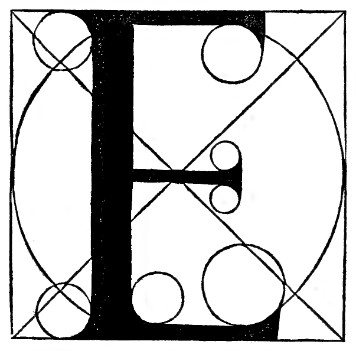

:layout: book
:canonical_id: Letter E
:folio: 0147

.. _plates-alphabet-e-it:

Lettera E (Folio 0147)
======================

.. rubric:: Proporzioni costruttive della lettera e

.. folio:: 0147

   Lettera E (Folio 0147)

Questa lettera E se cava del tondo e del suo quadro. La :term:`gamba grossa <gamba-grossa>` vol esser de le nove parti luna. La gamba desopra vol esser per la mita de la :term:`gamba grossa <gamba-grossa>`, quella de sotto per simile. Quella de mezo per terza parte de la :term:`gamba grossa <gamba-grossa>` comme quella de mezo del A, e la detta lettera vol esser larga meza del suo quadro et sic erit perfectissima.
