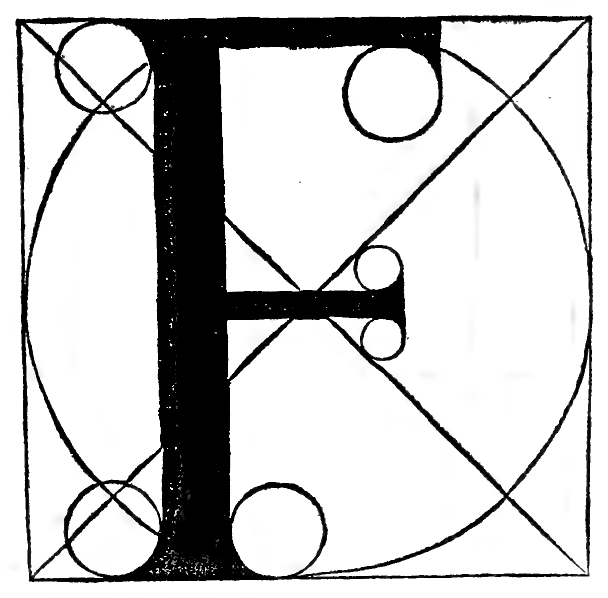

:layout: book
:canonical_id: Letter F
:folio: 0149

.. _plates-alphabet-f-de:

Buchstabe F (Folio 0149)
========================

.. rubric:: Konstruktive Proportionen des Buchstabens F

.. folio:: 0149

   Lettera F (Folio 0149)

Dieser Buchstabe F bildet sich auf die Art wie der Buchstabe E, weder mehr noch weniger, ausgenommen dass F ohne das dritte Bein ist, wie du es deutlich am Ort besagten E vor Augen gehabt hast mit allen seinen Proportionen. Darum möge hier dieses dir genügen.
