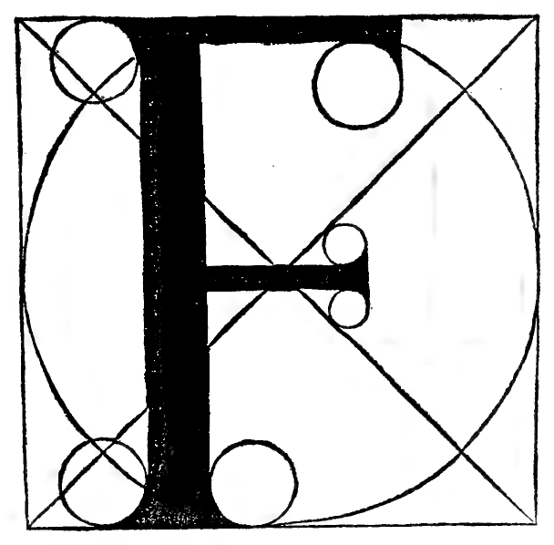

:layout: book
:canonical_id: Letter F
:folio: 0149

.. _plates-alphabet-f:
.. _plates-alphabet-f-en:

Letter F (Folio 0149)
=====================

.. rubric:: Constructive Proportions of Capital Letter F

.. folio:: 0149

   Lettera F (Folio 0149)

This letter F is formed in the exact same manner as the letter E, neither more nor less, except that F lacks the third [lowest] arm, as you had at length in the place of the said E with all its proportions; wherefore let that suffice here.
