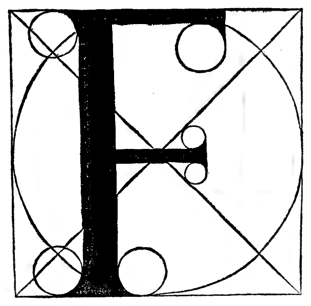

:layout: book
:canonical_id: Letter F
:folio: 0149

.. _plates-alphabet-f-it:

Lettera F (Folio 0149)
======================

.. rubric:: Proporzioni costruttive della lettera f

.. folio:: 0149

   Lettera F (Folio 0149)

Questa lettera F se forma a quel modo come la lettera E ne più ne mancho excepto che F si e senza la terza gamba: come denanci havesti diffusamente al luoco de ditto E cum tutte suo proportioni, pero qui quello te basti.
