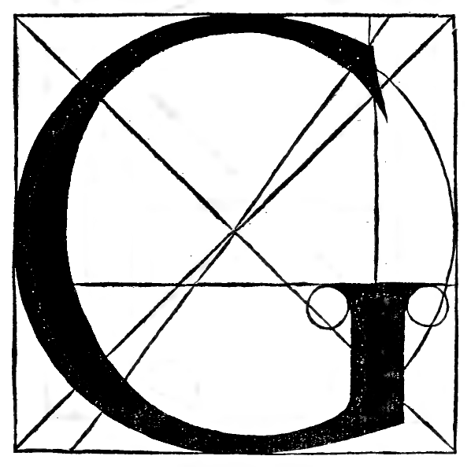

:layout: book
:canonical_id: Letter G
:folio: 0151

.. _plates-alphabet-g-de:

Buchstabe G (Folio 0151)
========================

.. rubric:: Konstruktive Proportionen des Buchstabens G

.. folio:: 0151

   Lettera G (Folio 0151)

Dieser Buchstabe G bildet sich wie das C aus seinem Kreise und Vierseit. Das untere gerade Bein muss ein Drittel seiner Quadratseite hoch und einen der neun Theile der Höhe seines Quadrats dick sein.
