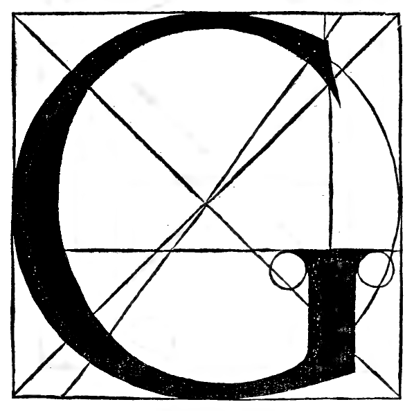

:layout: book
:canonical_id: Letter G
:folio: 0151

.. _plates-alphabet-g:
.. _plates-alphabet-g-en:

Letter G (Folio 0151)
=====================

.. rubric:: Constructive Proportions of Capital Letter G

.. folio:: 0151

   Lettera G (Folio 0151)

This letter G is formed like the C from its circle and square. The upright lower stem is one-third of its square in height, and one-ninth of the height of its square in thickness.
