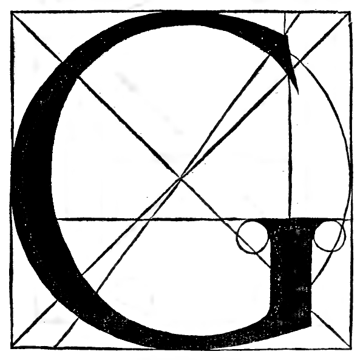

:layout: book
:canonical_id: Letter G
:folio: 0151

.. _plates-alphabet-g-it:

Lettera G (Folio 0151)
======================

.. rubric:: Proporzioni costruttive della lettera g

.. folio:: 0151

   Lettera G (Folio 0151)

Questa letera G si forma commel C del suo :term:`tondo e quadro <tondo-e-quadro>`. La gamba deritta de sotto vol esser alta un terzo del suo quadro: e grossa de le nove parti luna de lalteza del suo quadrato.
