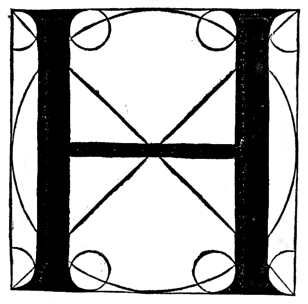

:layout: book
:canonical_id: Letter H
:folio: 0153

.. _plates-alphabet-h-de:

Buchstabe H (Folio 0153)
========================

.. rubric:: Konstruktive Proportionen des Buchstabens H

.. folio:: 0153

   Lettera H (Folio 0153)

Dieser Buchstabe H wird aus dem Kreise und seinem Vierseit abgeleitet. Seine dicken Beine werden mittelst der Kreuzungspunkte gemacht, d. h. wo die Peripherie des Kreises und die Diagonalen des Quadrats sich schneiden. Die Dicke besagter Beine muss einen der neun Theile der Höhe betragen, und das mittlere wird mittelst des Durchmessers gemacht. Seine Dicke muss den dritten Theil des dicken Beines betragen, wie der Querbalken des A.

.. note:: **Anmerkung von Constantin Winterberg (1889)**:

   **Winterberg Anmerkung (1889, S. 358)**: *\*) Soll heissen: wo Peripherie des Kreises und Diagonalen des Quadrats sich schneiden.*
