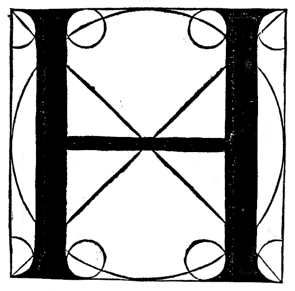

:layout: book
:canonical_id: Letter H
:folio: 0153

.. _plates-alphabet-h:
.. _plates-alphabet-h-en:

Letter H (Folio 0153)
=====================

.. rubric:: Constructive Proportions of Capital Letter H

.. folio:: 0153

   Lettera H (Folio 0153)

This letter H is drawn from the circle and its square. Its two thick vertical stems are formed through the intersections where the circumference of the circle and the diagonals of the square cross. The thickness of the said stems is one-ninth of the height, and the crossbar is drawn along the horizontal diameter with a thickness equal to one-third of the thick stem, like the crossbar of the A.

.. note:: **Winterberg Critical Footnote (1889)**:

   **Winterberg Note (1889, p. 358)**: In the 1509 Italian text (*'doue se intersecano li diametri del tondo suo quadro'*), read more precisely: *where the circumference (periphery) of the circle and the diagonals of its square intersect*.
