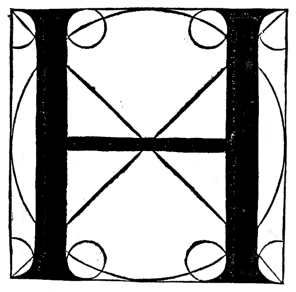

:layout: book
:canonical_id: Letter H
:folio: 0153

.. _plates-alphabet-h-it:

Lettera H (Folio 0153)
======================

.. rubric:: Proporzioni costruttive della lettera h

.. folio:: 0153

   Lettera H (Folio 0153)

Questa lettera H si cava del tondo e del suo quadro. Le sue gambe grosse si fanno per mezo le crosiere cioè dove se intersecano li diametri del tondo e suo quadro. La grosseza de ditte gambe vol esser de le nove parti una de lalteza. E quella de mezo se fa per mezo el diametro: la sua grosseza vol esser la terza parte de la :term:`gamba grossa <gamba-grossa>` commel traverso del A.
