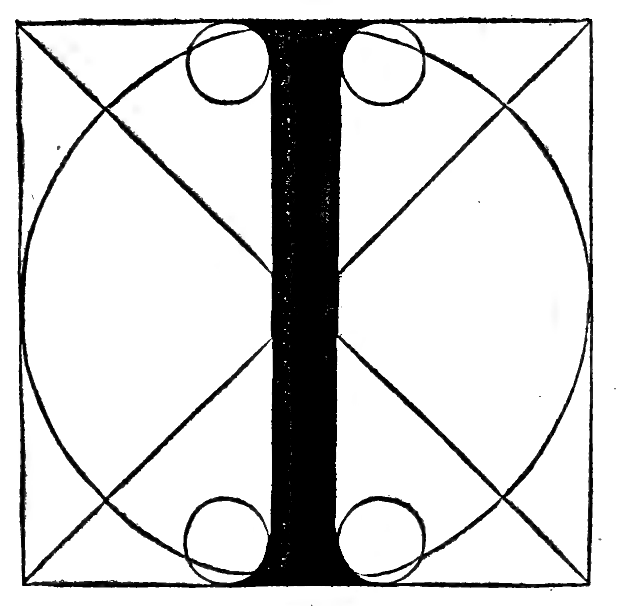

:layout: book
:canonical_id: Letter I / J
:folio: 0155

.. _plates-alphabet-i-de:

Buchstabe I / J (Folio 0155)
============================

.. rubric:: Konstruktive Proportionen des Buchstabens J

.. folio:: 0155

   Lettera I / J (Folio 0155)

Dieser Buchstabe I (J) wird aus dem Kreise und Vierseit entnommen. Seine Dicke muss einen von den neun Theilen betragen, so dass seine Bildung vor den übrigen leicht ist.
