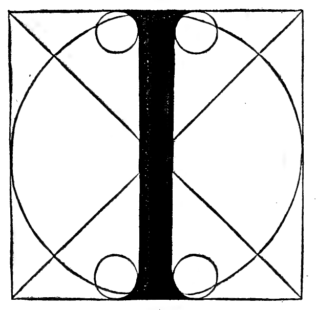

:layout: book
:canonical_id: Letter I / J
:folio: 0155

.. _plates-alphabet-i:
.. _plates-alphabet-i-en:

Letter I / J (Folio 0155)
=========================

.. rubric:: Constructive Proportions of Capital Letter I / J

.. folio:: 0155

   Lettera I / J (Folio 0155)

This letter I is drawn from the circle and the square; its thickness is one-ninth of the height, so that its formation is the easiest among the others.
