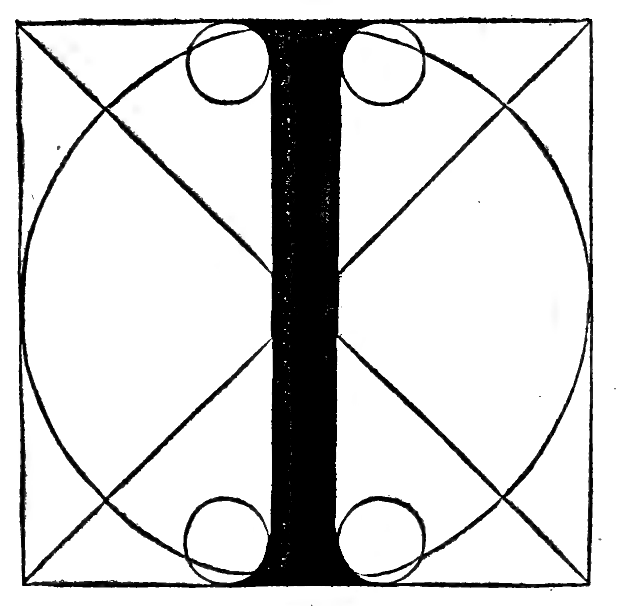

:layout: book
:canonical_id: Letter I / J
:folio: 0155

.. _plates-alphabet-i-it:

Lettera I / J (Folio 0155)
==========================

.. rubric:: Proporzioni costruttive della lettera i / j

.. folio:: 0155

   Lettera I / J (Folio 0155)

Questa lettera I se cava del tondo e del quadro; la sua grosseza vol esser de le nove parti luna che facil fia sua formatione fra laltre.
