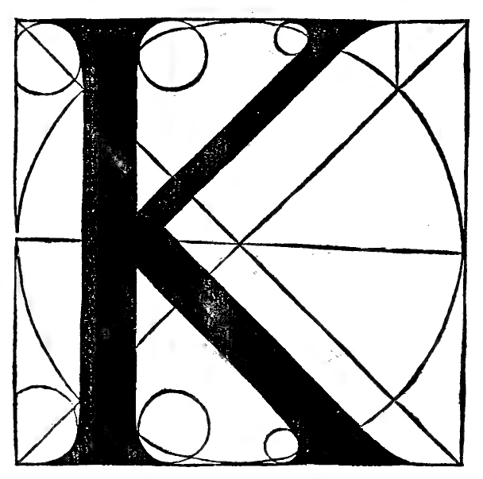

:layout: book
:canonical_id: Letter K
:folio: 0157

.. _plates-alphabet-k-de:

Buchstabe K (Folio 0157)
========================

.. rubric:: Konstruktive Proportionen des Buchstabens K

.. folio:: 0157

   Lettera K (Folio 0157)

Dieser Buchstabe K wird aus dem Kreise und seinem Vierseit entnommen, indem man eine Linie als Durchmesser des Vierseits zieht. In dieser Linie beschliessen und beendigen sich die beiden Beine in der Mitte des dicken Beines. Das untere Bein muss wie die übrigen Beine einen der neun Theile dick sein; das obere die Hälfte des dicken, wie das linke des A. Das untere muss bis zum Kreuzungspunkt oder darüber hinaus lang sein; das obere bleibt innerhalb des Kreuzungspunktes.
