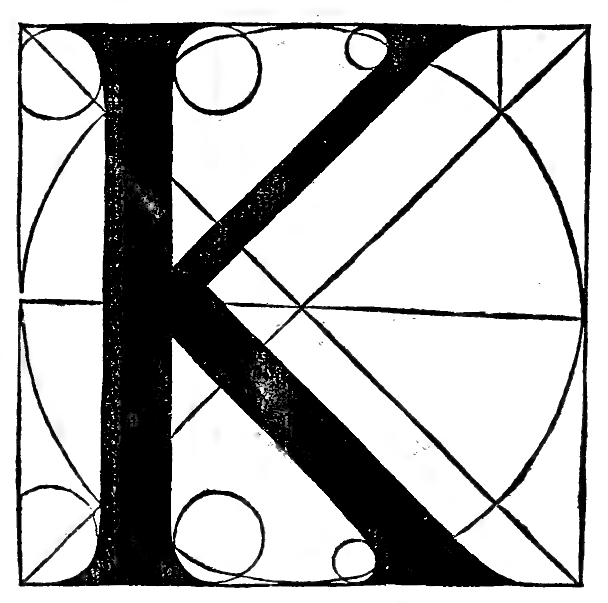

:layout: book
:canonical_id: Letter K
:folio: 0157

.. _plates-alphabet-k:
.. _plates-alphabet-k-en:

Letter K (Folio 0157)
=====================

.. rubric:: Constructive Proportions of Capital Letter K

.. folio:: 0157

   Lettera K (Folio 0157)

This letter K is drawn from the circle and its square by drawing a diagonal of the square, upon which the two oblique branches meet and terminate at the middle of the thick stem. The lower branch is one-ninth in thickness like the other thick stems; the upper branch is half as thick, like the left leg of the A. The lower branch extends to or slightly beyond the diagonal intersection; the upper remains within the intersection.
