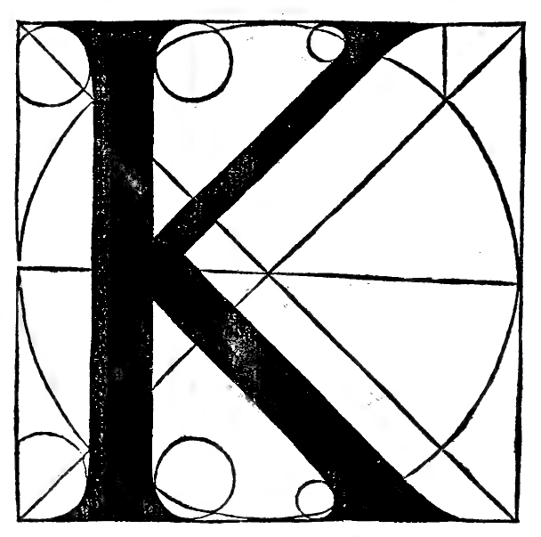

:layout: book
:canonical_id: Letter K
:folio: 0157

.. _plates-alphabet-k-it:

Lettera K (Folio 0157)
======================

.. rubric:: Proporzioni costruttive della lettera k

.. folio:: 0157

   Lettera K (Folio 0157)

Questa lettera K se cava del tondo e del suo quadro tirando una linea per diametro del quadro; in questa linea se ferma e termina le due gambe per mezo la :term:`gamba grossa <gamba-grossa>`. La gamba de sotto vol esser grossa comme laltre gambe una parte de le nove. Quella de sopra la mita de la grossa comme la sinistra del A. Quella de sotto vol esser longa fin ala crociera over di fora. Quella de sopra dentro la crociera.
