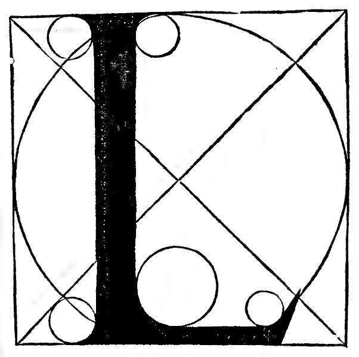

:layout: book
:canonical_id: Letter L
:folio: 0159

.. _plates-alphabet-l-de:

Buchstabe L (Folio 0159)
========================

.. rubric:: Konstruktive Proportionen des Buchstabens L

.. folio:: 0159

   Lettera L (Folio 0159)

Dieser Buchstabe L wird aus dem Kreise und seinem Vierseit entnommen. Seine Dicke muss einen der neun Theile der Höhe betragen. Seine Breite die Hälfte der Quadratseite mit den darüber beschriebenen Rundungen. Das dünne Bein muss unten halb so dick sein wie das dicke, wie das des E und des F.
