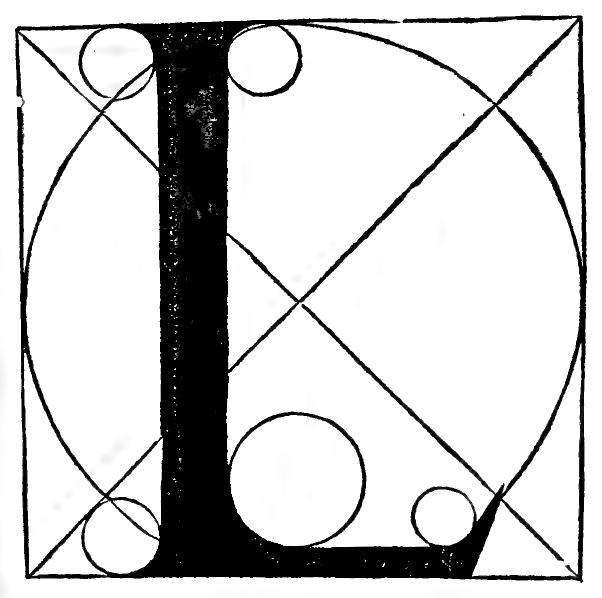

:layout: book
:canonical_id: Letter L
:folio: 0159

.. _plates-alphabet-l:
.. _plates-alphabet-l-en:

Letter L (Folio 0159)
=====================

.. rubric:: Constructive Proportions of Capital Letter L

.. folio:: 0159

   Lettera L (Folio 0159)

This letter L is drawn from the circle and its square. Its vertical stem is one-ninth of the height in thickness, and its width is half the square with the small circles shown above. The thin lower arm is half the thickness of the vertical stem, like that of the E and the F.
