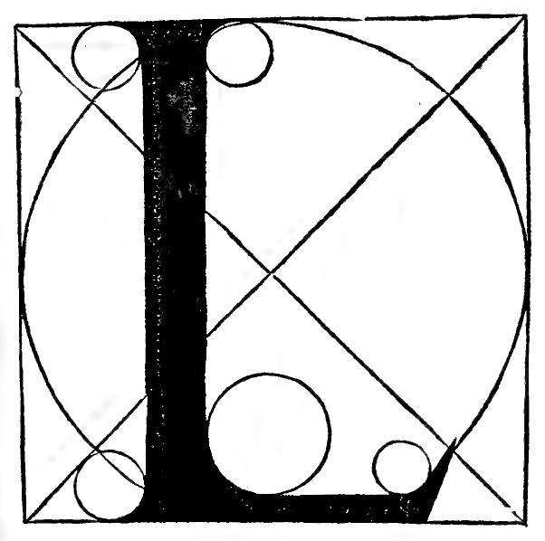

:layout: book
:canonical_id: Letter L
:folio: 0159

.. _plates-alphabet-l-it:

Lettera L (Folio 0159)
======================

.. rubric:: Proporzioni costruttive della lettera l

.. folio:: 0159

   Lettera L (Folio 0159)

Questa lettera L se cava del tondo e del suo quadro. La sua grosseza vol esser de le nove parti una de laltezza. La sua largheza mezo quadro cum questi tondi soprascripti. La gamba sutile de sotto vol esser per la mita de la grossa comme quella del E et del F.
