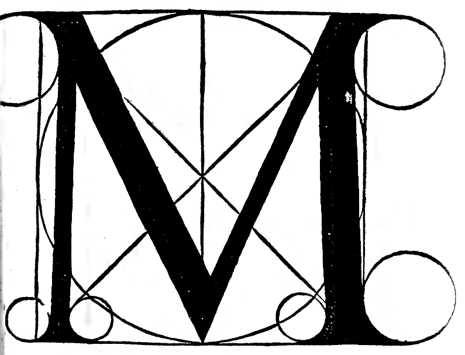

:layout: book
:canonical_id: Letter M
:folio: 0161

.. _plates-alphabet-m-de:

Buchstabe M (Folio 0161)
========================

.. rubric:: Konstruktive Proportionen des Buchstabens M

.. folio:: 0161

   Lettera M (Folio 0161)

Dieser Buchstabe M wird aus dem Kreise und seinem Quadrat entnommen. Die dünnen Beine müssen halb so dick sein wie die dicken, wie das linke des A. Die äusseren Beine müssen ein wenig einwärts in das Quadrat treten; die mittleren liegen zwischen jenen und den Durchschnitten der Durchmesser. Ihre Dicken, dickere und dünnere, verhalten sich wie die des A, wie du aus der Figur deutlich verstehen kannst.
