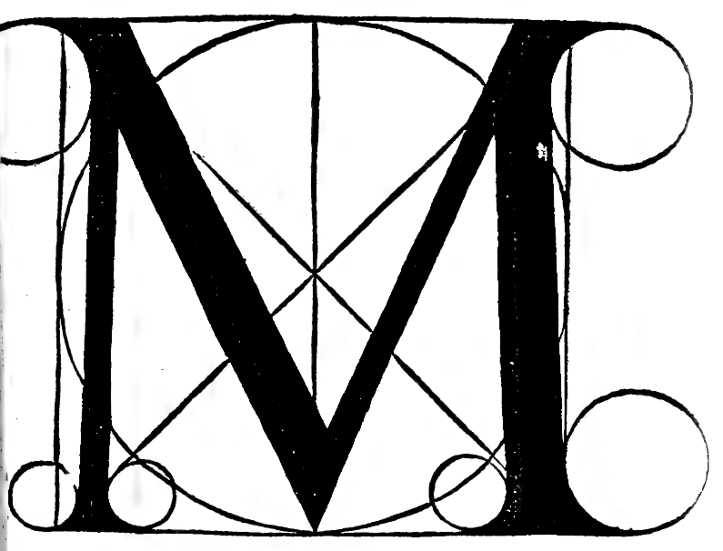

:layout: book
:canonical_id: Letter M
:folio: 0161

.. _plates-alphabet-m:
.. _plates-alphabet-m-en:

Letter M (Folio 0161)
=====================

.. rubric:: Constructive Proportions of Capital Letter M

.. folio:: 0161

   Lettera M (Folio 0161)

This letter M is drawn from the circle and its square. The thin legs are half the thickness of the thick legs, like the left leg of the A. The outer legs stand slightly inside the square, and the middle strokes meet at the intersection of the diameters; their thick and thin strokes correspond to those of the A, as you may clearly understand from the figure above.
