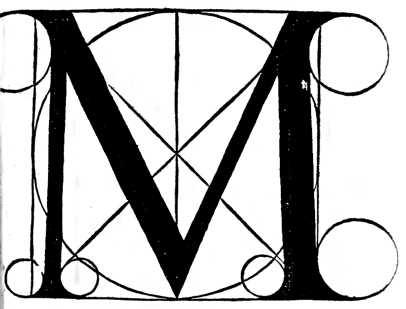

:layout: book
:canonical_id: Letter M
:folio: 0161

.. _plates-alphabet-m-it:

Lettera M (Folio 0161)
======================

.. rubric:: Proporzioni costruttive della lettera m

.. folio:: 0161

   Lettera M (Folio 0161)

Questa lettera M se cava del tondo e del suo quadro. Le gambe suttili vogliano esser per mezo de le grosse comme la senistra del A. Le extreme gambe vogliano esser alquanto dentro al quadro; le medie fra quelle e le intersecationi de li diametri; lor grosseze grosse e sutili se referiscano a quelle del A comme disopra in figura aperto poi comprendere.
