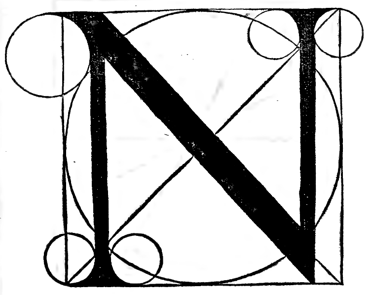

:layout: book
:canonical_id: Letter N
:folio: 0163

.. _plates-alphabet-n-de:

Buchstabe N (Folio 0163)
========================

.. rubric:: Konstruktive Proportionen des Buchstabens N

.. folio:: 0163

   Lettera N (Folio 0163)

Dieser Buchstabe N wird aus seinem Kreise und aus dem Quadrat entnommen. Das erste Bein muss ausserhalb des Durchschnittes der Durchmesser liegen. Das mittlere Querbein muss einen der neun Theile, diametral genommen, dick sein. Das dritte Bein muss ausserhalb des Kreuzungspunktes liegen. Erstes und letztes Bein müssen halb so dick sein wie das dicke Bein, nämlich eine halbe Kopflänge (1/18 der Quadratseite).

.. note:: **Anmerkung von Constantin Winterberg (1889)**:

   **Winterberg Anmerkung (1889, S. 359)**: *\*) D. h. 1/18 der Quadratseite.*
