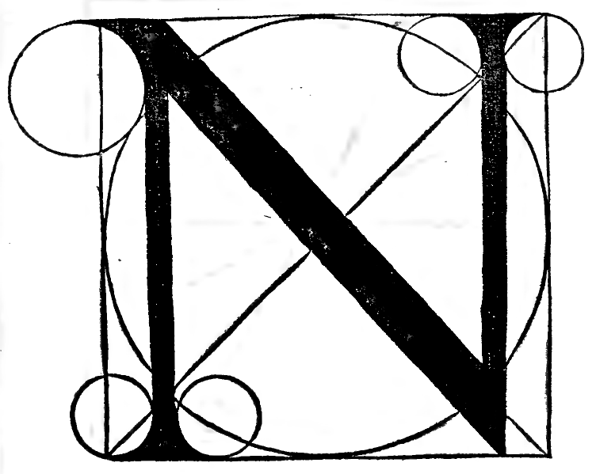

:layout: book
:canonical_id: Letter N
:folio: 0163

.. _plates-alphabet-n:
.. _plates-alphabet-n-en:

Letter N (Folio 0163)
=====================

.. rubric:: Constructive Proportions of Capital Letter N

.. folio:: 0163

   Lettera N (Folio 0163)

This letter N is drawn from its circle and square. The first vertical leg stands outside the intersection of the diagonals; the middle diagonal stroke is one-ninth in thickness taken diametrically; the third leg stands outside the intersection. The first and last vertical legs are half the thickness of the thick diagonal stroke, namely half a head [one-eighteenth of the square].

.. note:: **Winterberg Critical Footnote (1889)**:

   **Winterberg Note (1889, p. 359)**: By *'la mita de la gamba grossa cioè duna testa'* ('half the thick leg, namely one head'), :person:`Pacioli <pacioli>` means :math:`\frac{1}{2} \times \frac{1}{9} = \frac{1}{18}` of the side of the square.
