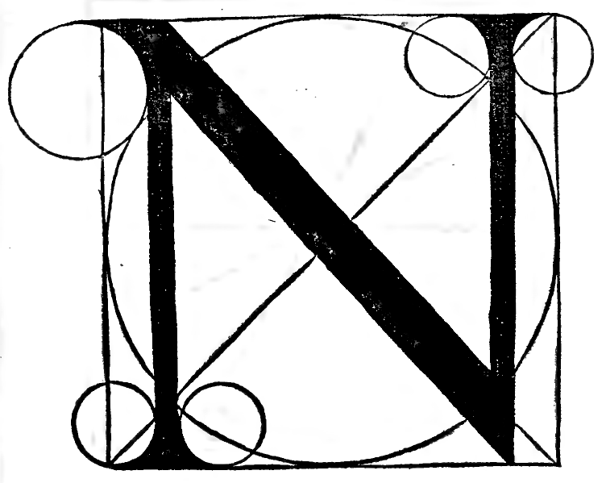

:layout: book
:canonical_id: Letter N
:folio: 0163

.. _plates-alphabet-n-it:

Lettera N (Folio 0163)
======================

.. rubric:: Proporzioni costruttive della lettera n

.. folio:: 0163

   Lettera N (Folio 0163)

Questa lettera N se cava del suo tondo et etiam quadro. La prima gamba vol esser fora de la intersecatione de li diametri. La traversa de mezo vol esser grossa de le nove parti luna presa diametraliter. La terza gamba vol esser fora de la crociera. Prima gamba et ultima vogliano esser grosse la mita de la :term:`gamba grossa <gamba-grossa>` cioè duna testa.
