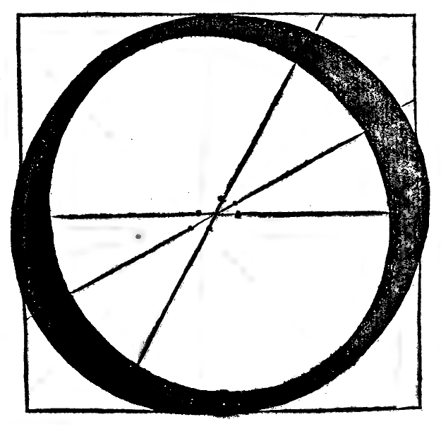

:layout: book
:canonical_id: Letter O (Primo Modo)
:folio: 0165

.. _plates-alphabet-o_1-de:

Buchstabe O (erste Weise) (Folio 0165)
======================================

.. rubric:: Konstruktive Proportionen des Buchstabens Modo)

.. folio:: 0165

   Lettera O (primo modo perfectissimo) (Folio 0165)

Dieses O ist sehr vollkommen.
