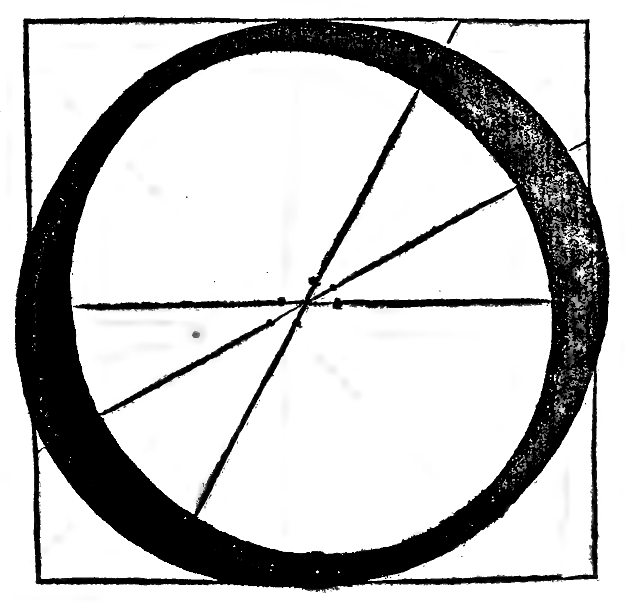

:layout: book
:canonical_id: Letter O (Primo Modo)
:folio: 0165

.. _plates-alphabet-o_1-it:

Lettera O (primo modo) (Folio 0165)
===================================

.. rubric:: Proporzioni costruttive della lettera o (primo modo)

.. folio:: 0165

   Lettera O (primo modo perfectissimo) (Folio 0165)

Questo O è perfectissimo.
