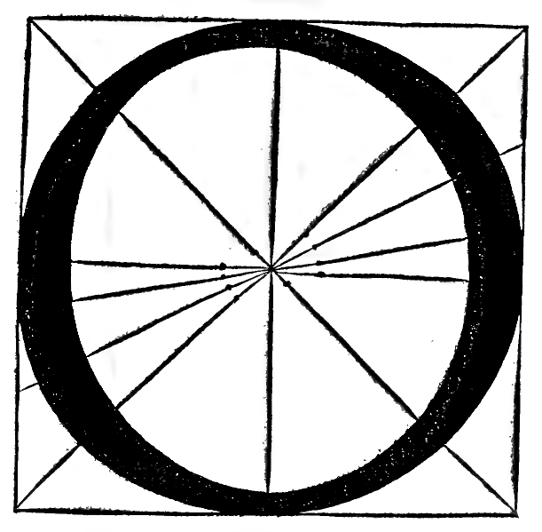

:layout: book
:canonical_id: Letter O (Secondo Modo)
:folio: 0167

.. _plates-alphabet-o_2-de:

Buchstabe O (zweite Weise) (Folio 0167)
=======================================

.. rubric:: Konstruktive Proportionen des Buchstabens Modo)

.. folio:: 0167

   Lettera O (secondo modo) (Folio 0167)

Dieser Buchstabe O wird aus dem Kreise und seinem Quadrat entnommen. Es wird in vier Theile getheilt, d. h. kreuzweise mittelst der vier Mittellinien. Sein Körper muss einen der neun Theile dick sein, und sein Körper muss oben halb so dick sein als sein dicker Theil. Von seinen Bäuchen muss einer aufwärts, der andere abwärts hängen. Der dünne Theil des Körpers muss ein Drittel seines Bauches dick sein. Und weil darüber zwei Meinungen herrschen, so habe ich dir noch einen anderen hingesetzt, der nach meinem Gefallen sehr vollkommen ist, und du nimmst, welcher dir gut dünkt, und wirst aus ihnen das Q bilden.
