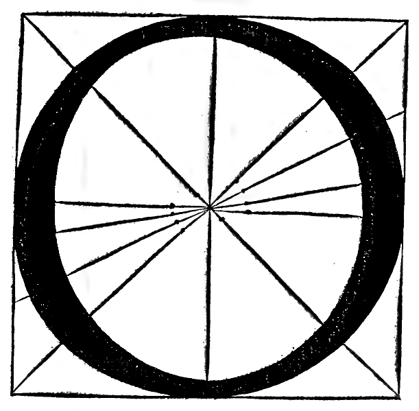

:layout: book
:canonical_id: Letter O (Secondo Modo)
:folio: 0167

.. _plates-alphabet-o_2:
.. _plates-alphabet-o_2-en:

Letter O (Secondo Modo) (Folio 0167)
====================================

.. rubric:: Constructive Proportions of Capital Letter O (Secondo Modo)

.. folio:: 0167

   Lettera O (secondo modo) (Folio 0167)

This letter O is drawn from the circle and its square, divided into four parts crosswise by the four central lines. Its body is one-ninth in thickness; its upper part is half the thickness of its thick belly. One of its bellies inclines upward and the other downward; the thin part of the body is one-third of its belly. And because there are two opinions concerning it, I have set another one before you that is most perfect according to my judgment; take whichever pleases you, and from them you will form the Q, as you will understand below in its place.
