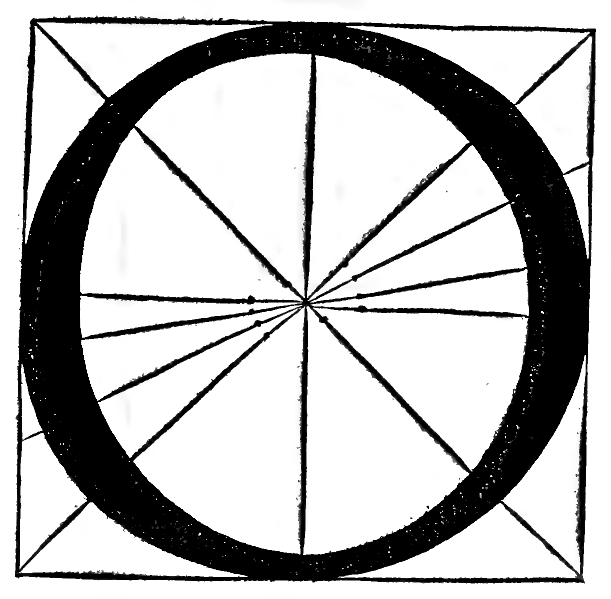

:layout: book
:canonical_id: Letter O (Secondo Modo)
:folio: 0167

.. _plates-alphabet-o_2-it:

Lettera O (secondo modo) (Folio 0167)
=====================================

.. rubric:: Proporzioni costruttive della lettera o (secondo modo)

.. folio:: 0167

   Lettera O (secondo modo) (Folio 0167)

Questa lettera O si cava del tondo e del suo quadro. Se divide in quatro parti cioè in croce per mezo le quatro linee; el corpo suo vol esser grosso de le nove parti luna; el corpo suo de sopra vol esser per mezo del suo grosso. Le sue pance una vol pender in su laltra in giù; el sutile del corpo vol esser per la terza parte de la sua pancia. E perche di lui sonno doi opinioni pero te no posto un altro a mio piacere perfectissimo e tu prendi qual te pare e di loro formarai el Q comme disotto intenderai a suo luoco.
