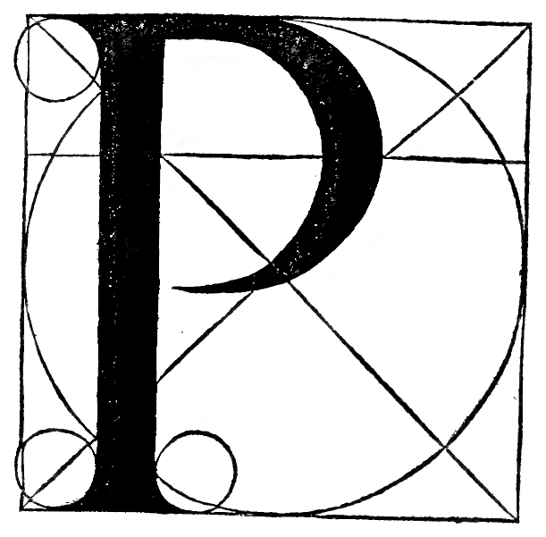

:layout: book
:canonical_id: Letter P
:folio: 0169

.. _plates-alphabet-p-de:

Buchstabe P (Folio 0169)
========================

.. rubric:: Konstruktive Proportionen des Buchstabens P

.. folio:: 0169

   Lettera P (Folio 0169)

Dieser Buchstabe P wird aus dem Kreise und seinem Vierseit entnommen. Sein dickes Bein muss einen der neun Theile betragen. Die Form des Runden muss so gross sein wie der untere des B und die Dicke des Bauches muss so gross sein wie das dicke Bein, und besagter Buchstabe muss an den Kreuzungspunkten des grossen Kreises beginnen, und so wird er sehr vollkommen sein.
