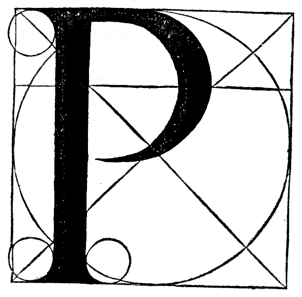

:layout: book
:canonical_id: Letter P
:folio: 0169

.. _plates-alphabet-p:
.. _plates-alphabet-p-en:

Letter P (Folio 0169)
=====================

.. rubric:: Constructive Proportions of Capital Letter P

.. folio:: 0169

   Lettera P (Folio 0169)

This letter P is drawn from the circle and its square. Its thick stem is one-ninth in thickness. The form of the bowl is as large as the lower bowl of the B, and the thickness of its belly equals the thick stem; and the said letter begins at the intersections of the diagonals of the great circle, and thus will be most perfect.
