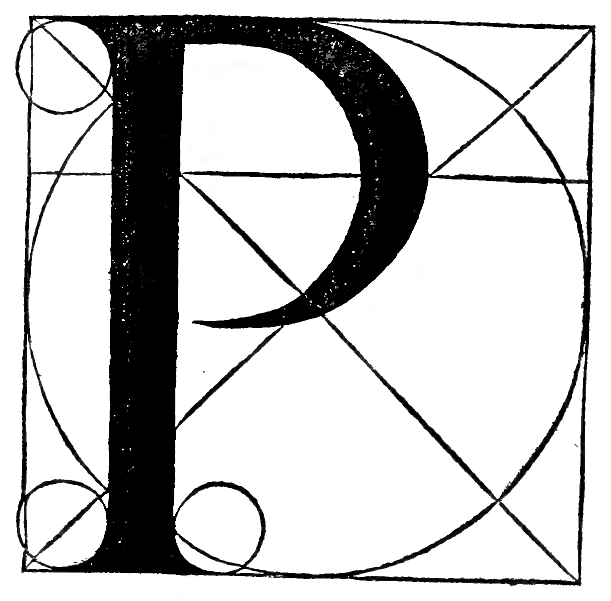

:layout: book
:canonical_id: Letter P
:folio: 0169

.. _plates-alphabet-p-it:

Lettera P (Folio 0169)
======================

.. rubric:: Proporzioni costruttive della lettera p

.. folio:: 0169

   Lettera P (Folio 0169)

Questa lettera P si cava del tondo e del suo quadro. La sua :term:`gamba grossa <gamba-grossa>` vol esser de le nove parti luna. La forma del tondo vol esser grande comme quella del B da basso, e la sua grosseza de la pancia vol esser tanto quanto la :term:`gamba grossa <gamba-grossa>` e si vol principiar ditta lettera da le crociere del tondo grande cioè da le intersecationi de li diametri et sic erit perfectissima.
