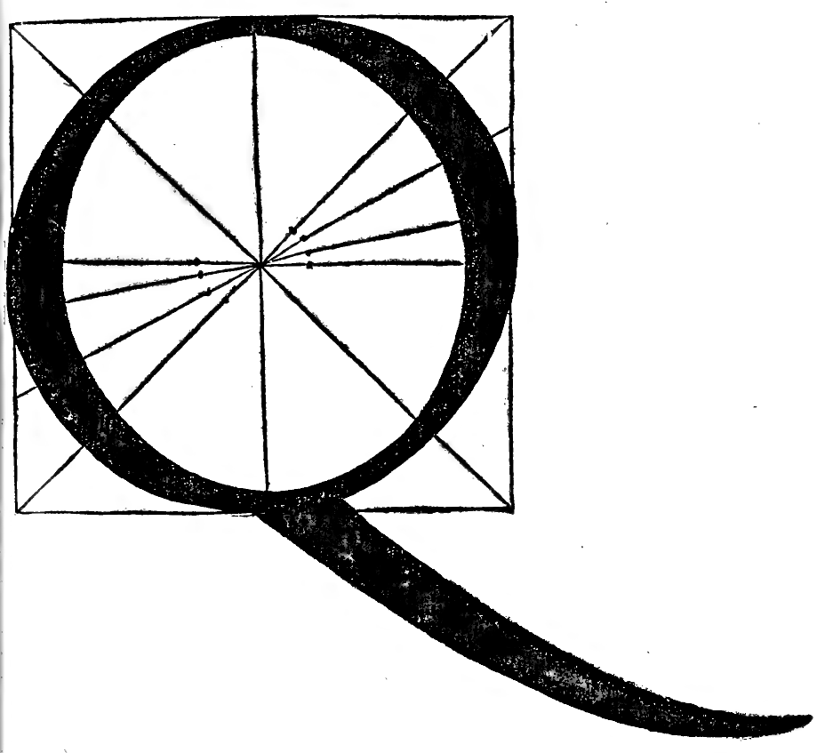

:layout: book
:canonical_id: Letter Q
:folio: 0171

.. _plates-alphabet-q-de:

Buchstabe Q (Folio 0171)
========================

.. rubric:: Konstruktive Proportionen des Buchstabens Q

.. folio:: 0171

   Lettera Q (Folio 0171)

Dieser Buchstabe Q wird, wie ich oben sagte, aus dem O entnommen, indem sein Bein drei Kopflängen seiner Höhe unterhalb des Quadrats, d. h. drei von den neun Theilen seiner Quadratseite oder Durchmesser seines Kreises endet, wie es hier im rechten Verhältniss erscheint, indem man die dicken Bäuche und seine dünnen entgegengesetzten genau wie beim O gesagt worden führt. Und sein Bein muss neun Kopflängen, d. h. so lang wie sein rechtwinkeliges Vierseit sein, und das Ende muss am obersten Punkte ein Neuntel der Höhe hoch sein, indem man der Krümmung der Feder mit der Abnahme seiner Dicke folgt.
