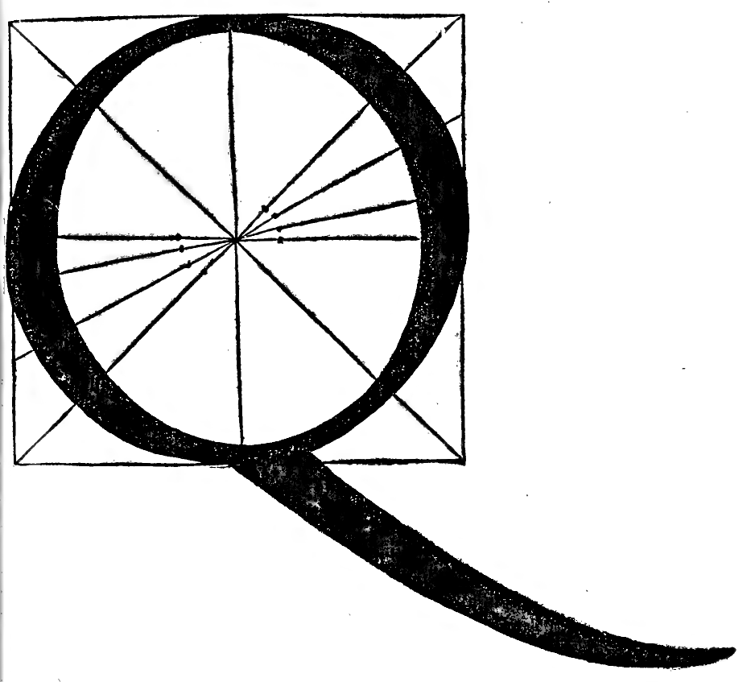

:layout: book
:canonical_id: Letter Q
:folio: 0171

.. _plates-alphabet-q:
.. _plates-alphabet-q-en:

Letter Q (Folio 0171)
=====================

.. rubric:: Constructive Proportions of Capital Letter Q

.. folio:: 0171

   Lettera Q (Folio 0171)

This letter Q, as I said above, is drawn from the O, terminating its tail three heads [three-ninths] of its height below the square, guiding the opposing thick bellies and thin strokes exactly as was told for the O. Its tail is nine heads long—that is, equal to the side of its right-angled square—and its tip rises one-ninth of the height at the end, following the curve of the pen with the tapering of its thickness.
