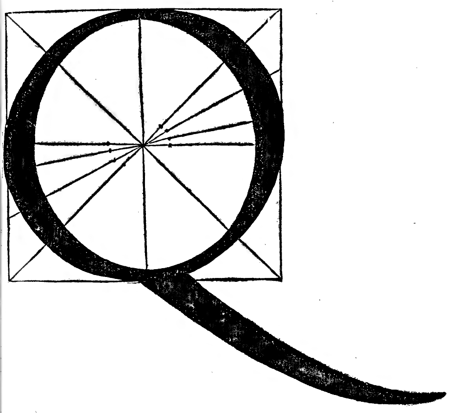

:layout: book
:canonical_id: Letter Q
:folio: 0171

.. _plates-alphabet-q-it:

Lettera Q (Folio 0171)
======================

.. rubric:: Proporzioni costruttive della lettera q

.. folio:: 0171

   Lettera Q (Folio 0171)

Questa letera Q comme disopra dissi se cava del O, terminando sua gamba tre teste de sua altezza sotto el quadrato cioè de le nove parti le tre del suo quadrato overo diametro del suo tondo comme qui appare proportionata, guidando le pance grosse e sue sutili opposite a poncto comme del O fo dicto. E la sua gamba vol esser longa nove teste cioè quanto el suo quadrato a rectangulo, e la fine vol esser alta la poncta in su un nono de laltezza sequendo la curvita de la penna con la degradatione de la sua grosseza.
