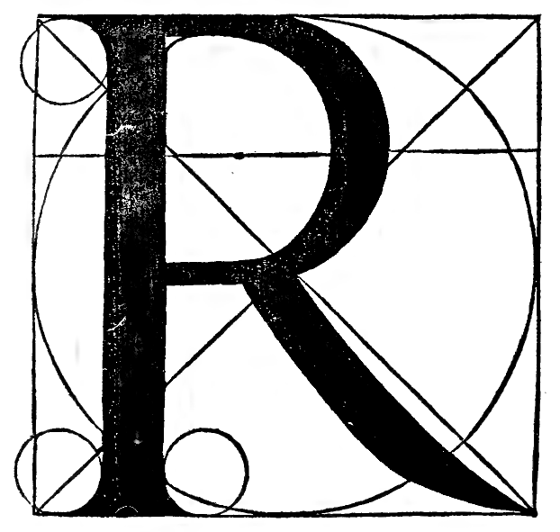

:layout: book
:canonical_id: Letter R
:folio: 0173

.. _plates-alphabet-r-de:

Buchstabe R (Folio 0173)
========================

.. rubric:: Konstruktive Proportionen des Buchstabens R

.. folio:: 0173

   Lettera R (Folio 0173)

Dieser Buchstabe R wird aus dem Buchstaben B abgeleitet. Seine Rundung geht um eine halbe Beindicke unterhalb des Centrums. Dieser ganze Buchstabe muss innerhalb der Kreuzungspunkte liegen, ausgenommen das gebogene Bein, welches über die Kreuzpunkte hinaus bis ans Ende des Vierseits gehen muss. Besagtes gebogenes Bein muss einen der neun Theile dick sein, indem es dünn in eine Spitze am Ende des Vierseits nach Art von krummen Linien ausläuft.
