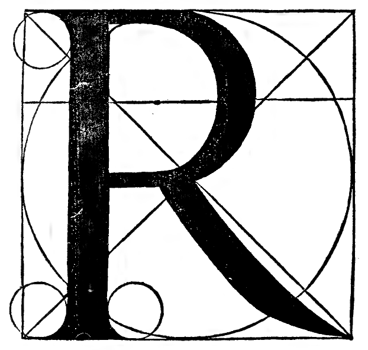

:layout: book
:canonical_id: Letter R
:folio: 0173

.. _plates-alphabet-r:
.. _plates-alphabet-r-en:

Letter R (Folio 0173)
=====================

.. rubric:: Constructive Proportions of Capital Letter R

.. folio:: 0173

   Lettera R (Folio 0173)

This letter R is derived from the letter B; its upper bowl extends half a stem-width below the center. The whole letter remains within the diagonal intersections except for the curved tail, which extends beyond the intersections to the corner of the square, having a thickness of one-ninth and tapering to a fine point at the angle of the square in curved lines, as is manifest here in the example.
