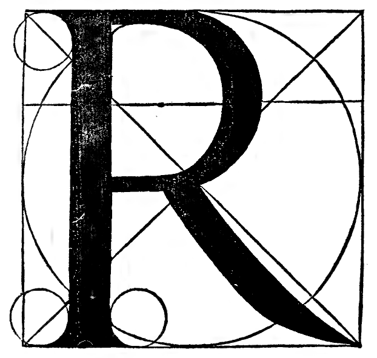

:layout: book
:canonical_id: Letter R
:folio: 0173

.. _plates-alphabet-r-it:

Lettera R (Folio 0173)
======================

.. rubric:: Proporzioni costruttive della lettera r

.. folio:: 0173

   Lettera R (Folio 0173)

Questa lettera R se cava de la lettera B; el suo tondo sie de sotto dal centro una meza gamba. Tutta questa lettera vol esser dentro de le croci excepto la gamba storta vol uscir for de le croci fin al fin del quadro. Dicta gamba storta vol esser grossa de le nove parti luna terminata sutile in ponta nellangulo del quadro a modo de curve linee ut hic in exemplo patet.
