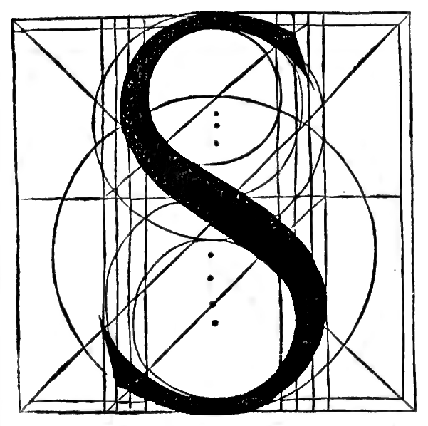

:layout: book
:canonical_id: Letter S
:folio: 0175

.. _plates-alphabet-s-de:

Buchstabe S (Folio 0175)
========================

.. rubric:: Konstruktive Proportionen des Buchstabens S

.. folio:: 0175

   Lettera S (Folio 0175)

Dieser Buchstabe S wird aus acht Kreisen entnommen und dieses ist sein Bildungsgesetz, wie hier im Beispiel erhellt. Nachdem du von diesen Kreisen mittelst ihrer Parallelen ihre Centra aufgefunden, so wirst du finden, dass die unteren um ein Drittel des Neuntels seines Quadrats grösser seien als die oberen. Der Bauch in der Mitte muss genau den neunten Theil der Höhe dick sein. Die dünneren Theile ein Drittel der Dicke, indem die Köpfe in anmuthiger Form endigen.

.. note:: **Anmerkung von Constantin Winterberg (1889)**:

   **Winterberg Anmerkung (1889, S. 360)**: *\*) In der Figur sind deren nur sechs angegeben.*
