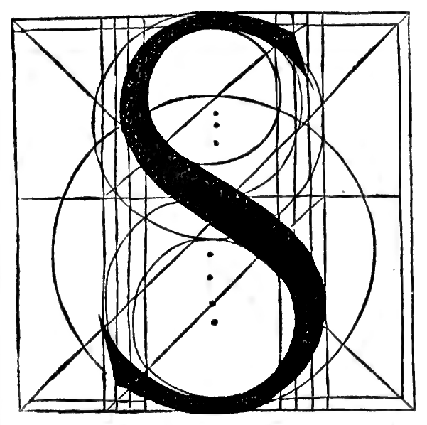

:layout: book
:canonical_id: Letter S
:folio: 0175

.. _plates-alphabet-s:
.. _plates-alphabet-s-en:

Letter S (Folio 0175)
=====================

.. rubric:: Constructive Proportions of Capital Letter S

.. folio:: 0175

   Lettera S (Folio 0175)

This letter S is drawn from eight circles, and this is its law of construction as appears here in the example: finding their centers by means of their parallel lines, you will find the lower circles to be larger than the upper by one-third of a ninth [one twenty-seventh] of its square. The middle belly is exactly one-ninth of the height in thickness, and the thin curves one-third of that thickness, terminating the heads with due grace.

.. note:: **Winterberg Critical Footnote (1889)**:

   **Winterberg Note (1889, p. 360)**: Although the text states that the letter **S** is drawn from *eight* circles (*'se caua de octo tondi'*), in the 1509 woodcut figure (Folio 0175, ``0175.g1.png``) only *six* construction circles are actually drawn.
