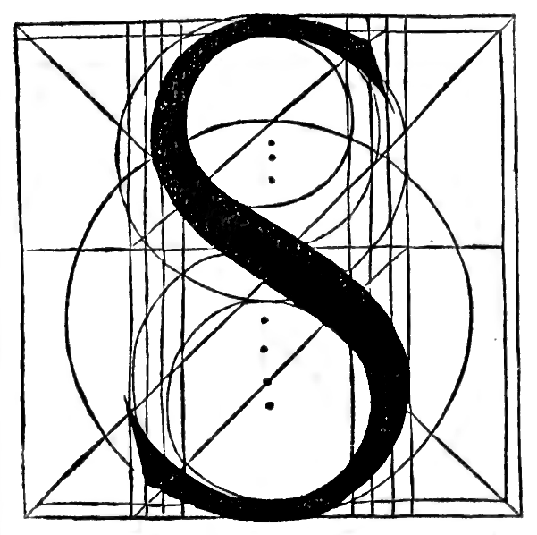

:layout: book
:canonical_id: Letter S
:folio: 0175

.. _plates-alphabet-s-it:

Lettera S (Folio 0175)
======================

.. rubric:: Proporzioni costruttive della lettera s

.. folio:: 0175

   Lettera S (Folio 0175)

Questa lettera S se cava de octo tondi et questa sie la sua ragione ut hic in exemplo apparet, li quali per le sue paralelle trovando lor centri troverai quelli de sotto esser magiori de li de sopra un terzo del nono del suo quadro. La pancia de mezzo vol esser grossa el nono aponto de lalteza. Le sutili un terzo de la grosseza terminando le teste con sua gratia.
