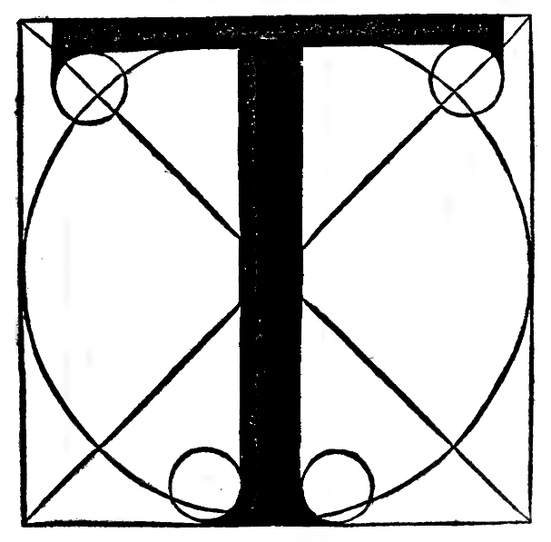

:layout: book
:canonical_id: Letter T
:folio: 0177

.. _plates-alphabet-t-de:

Buchstabe T (Folio 0177)
========================

.. rubric:: Konstruktive Proportionen des Buchstabens T

.. folio:: 0177

   Lettera T (Folio 0177)

Dieser Buchstabe T wird aus dem Quadrat und Kreise entnommen. Das dicke Bein muss genau so sein, wie beim I gesagt worden. Das Querbein muss halb so dick sein wie das dicke, wie das obere beim E und F, und muss um eine halbe Kopflänge beiderseits von den Ecken seiner Quadratseite enden, und wird beim Anblick sehr anmuthig.
