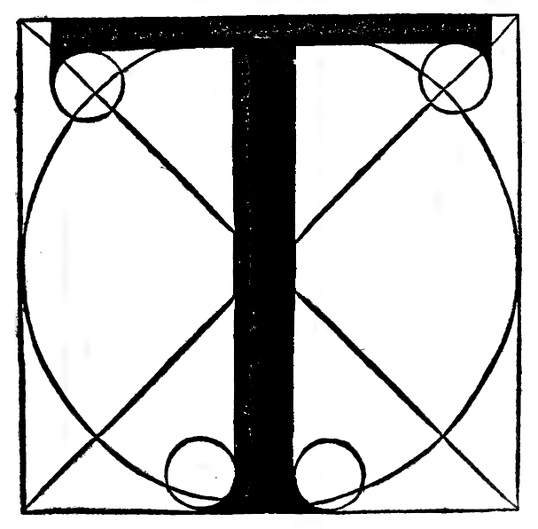

:layout: book
:canonical_id: Letter T
:folio: 0177

.. _plates-alphabet-t:
.. _plates-alphabet-t-en:

Letter T (Folio 0177)
=====================

.. rubric:: Constructive Proportions of Capital Letter T

.. folio:: 0177

   Lettera T (Folio 0177)

This letter T is drawn from its square and circle. The thick vertical stem is formed exactly as was said for the I. The horizontal crossbar is half the thickness of the vertical stem, like the upper arms of E and F, and terminates half a head [one-eighteenth] inside each side of its square, making it most pleasing to the sight.
