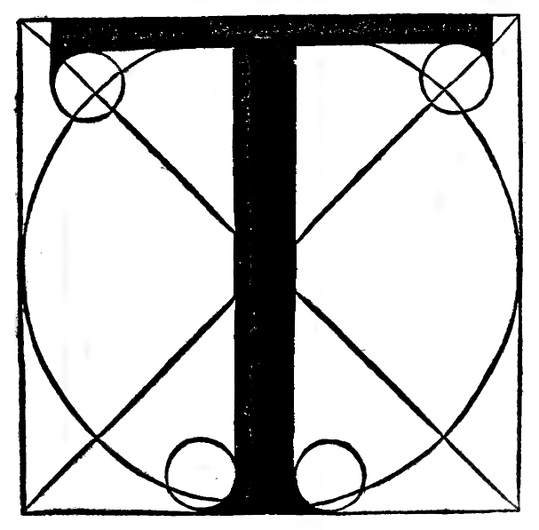

:layout: book
:canonical_id: Letter T
:folio: 0177

.. _plates-alphabet-t-it:

Lettera T (Folio 0177)
======================

.. rubric:: Proporzioni costruttive della lettera t

.. folio:: 0177

   Lettera T (Folio 0177)

Questa lettera T se cava del suo quadro e tondo. La :term:`gamba grossa <gamba-grossa>` vol esser a poncto comme del I fo detto. Quella traversa vol esser grossa per la mita de la grossa comme quelle disopra al E et F e vol terminare mezza testa per lato da le coste del suo quadro e fia ala vista gratissima.
