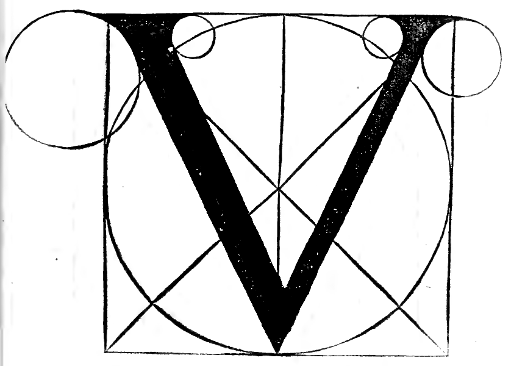

:layout: book
:canonical_id: Letter V
:folio: 0179

.. _plates-alphabet-v-de:

Buchstabe V (Folio 0179)
========================

.. rubric:: Konstruktive Proportionen des Buchstabens V

.. folio:: 0179

   Lettera V (Folio 0179)

Dieser Buchstabe V wird aus seinem ganzen vollen Quadrat entnommen. Das linke Bein muss den neunten Theil seines Quadrats, diametral genommen, dick sein, wie das rechte des A und quere des N. Das rechte halb so dick als das dicke, ebenfalls diametral genommen wie das linke des A, und endigt in einem Punkte in der Basis des Quadrates am Ende des Kreisdurchmessers.
