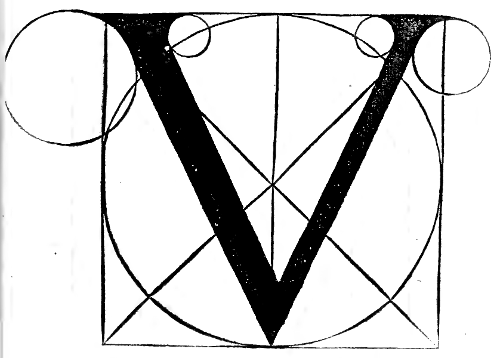

:layout: book
:canonical_id: Letter V
:folio: 0179

.. _plates-alphabet-v:
.. _plates-alphabet-v-en:

Letter V (Folio 0179)
=====================

.. rubric:: Constructive Proportions of Capital Letter V

.. folio:: 0179

   Lettera V (Folio 0179)

This letter V requires its entire square. The left leg is one-ninth of its square in thickness taken diametrically, like the right leg of the A and the diagonal of the N. The right leg is half the thickness of the thick leg, likewise taken diametrically like the left leg of the A, and terminates in a point at the base of the square at the end of the vertical diameter of the circle.
