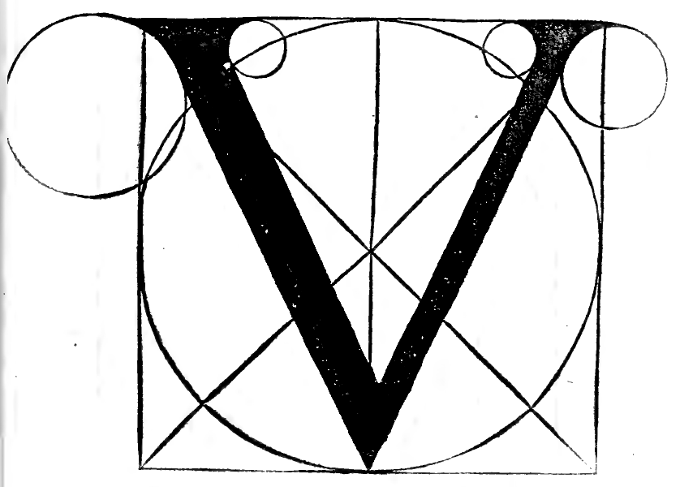

:layout: book
:canonical_id: Letter V
:folio: 0179

.. _plates-alphabet-v-it:

Lettera V (Folio 0179)
======================

.. rubric:: Proporzioni costruttive della lettera v

.. folio:: 0179

   Lettera V (Folio 0179)

Questa lettera V se cava del suo quadro tutto intero. La gamba senistra vol esser grossa el nono del suo quadro presa diametraliter comme la dextra del A e traversa del N. La dextra la mita de la grossa pur diametraliter presa comme la senistra del A e termina poncto nella basa del quadro in fin del diametro del tondo.
