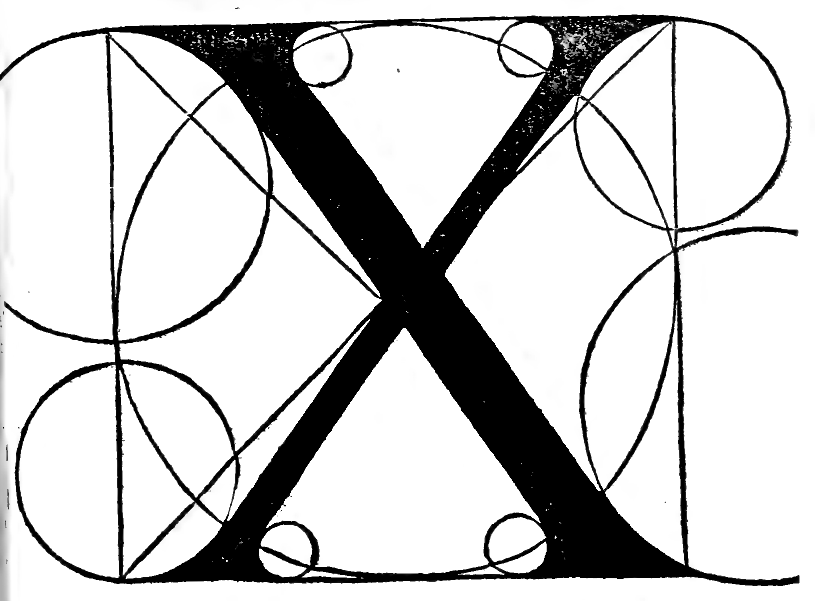

:layout: book
:canonical_id: Letter X
:folio: 0181

.. _plates-alphabet-x-de:

Buchstabe X (Folio 0181)
========================

.. rubric:: Konstruktive Proportionen des Buchstabens X

.. folio:: 0181

   Lettera X (Folio 0181)

Dieser Buchstabe X bedarf seines ganzen Quadrats, indem sich seine Beine im Durchschnitt der Durchmesser kreuzen. Und das eine muss den neunten Theil der Höhe dick sein, das andere die Hälfte davon, beide diametral genommen, indem seine Beine mit erforderlicher Anmuth gemäss dem Zwange der kleinen Kreise endigen.
