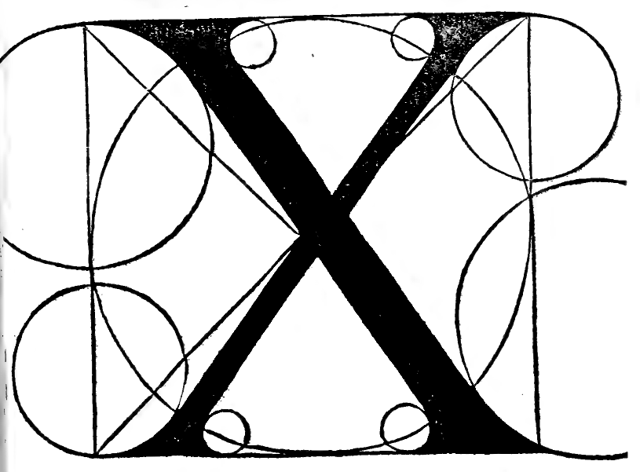

:layout: book
:canonical_id: Letter X
:folio: 0181

.. _plates-alphabet-x:
.. _plates-alphabet-x-en:

Letter X (Folio 0181)
=====================

.. rubric:: Constructive Proportions of Capital Letter X

.. folio:: 0181

   Lettera X (Folio 0181)

This letter X requires its entire square, crossing its legs at the central intersection of the diagonals. One leg is one-ninth of the height in thickness, and the other half as thick, taken diametrically, terminating its legs with due grace according to the curvature of the small circles.
